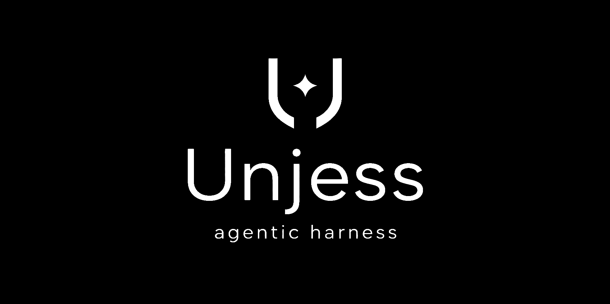

<p align="center">
  <picture>
    <source media="(prefers-color-scheme: dark)" srcset="assets/logo_banner.png">
    <source media="(prefers-color-scheme: light)" srcset="assets/logo_banner_light.png">
    
  </picture>
</p>

# Unjess

**Unjess** (`v4.0.0`) is a native **Rust** autonomous AI coding and security engineering harness built as a self-contained Cargo workspace.

---

## Architecture

| Crate | Binary | Description |
| :--- | :--- | :--- |
| `crates/unjess-core` | *(lib)* | Core autonomous agent loop, multi-provider LLM client (Ollama, llama.cpp, LM Studio, Google Gemini, Anthropic Claude, OpenAI, Groq, Mistral, xAI, OpenRouter, Cerebras, Kimi, Qwen, Custom Providers), sandboxed tool engine with automatic file diff tracking & 1-click revert, AST code intelligence, Red Team vs. White Team Security Duel scanner, Model Context Protocol (`2025-06-18`) client, multi-file Skills & companion script engine, Cron/Interval Scheduler, Cross-Session Memory store, and embedded Tokio/Axum server. |
| `crates/unjess-desktop` | `Unjess.exe` | Native GPU-rendered desktop application (`eframe` / `egui`) running `Arc<HarnessManager>` directly in-process (zero HTML, zero JS, zero WebView2). |
| `crates/unjess-daemon` | `unjessd.exe` | Standalone headless Tokio + Axum daemon binary (`--host 127.0.0.1 --port 9758`). |
| `crates/unjess-cli` | `unjess-cli.exe` | Terminal CLI & interactive REPL (`clap`) supporting single-shot prompts, interactive slash commands (`/help`, `/model`, `/models`, `/mode`, `/compact`, `/budget`, `/mcp`, `/skills`, `/duel`, `/memory`, `/clear`, `/version`, `/exit`), and subcommands (`doctor`, `models`, `duel`, `version`). |
| `crates/unjess-installer` | `Unjess-Setup.exe` | Native Windows installer. |
| `crates/unjess-uninstaller` | `Unjess-Uninstall.exe` | Native Windows uninstaller. |

---

## Building & Testing

Run the full build and test pipeline from PowerShell:

```powershell
.\build-all.ps1
```

Or run standard Cargo workspace commands directly:

```powershell
# Run all unit tests across the workspace
cargo test --workspace

# Compile optimized release binaries
cargo build --release --workspace
```

All compiled binaries are output to `target\release\` and staged into `dist\`.
